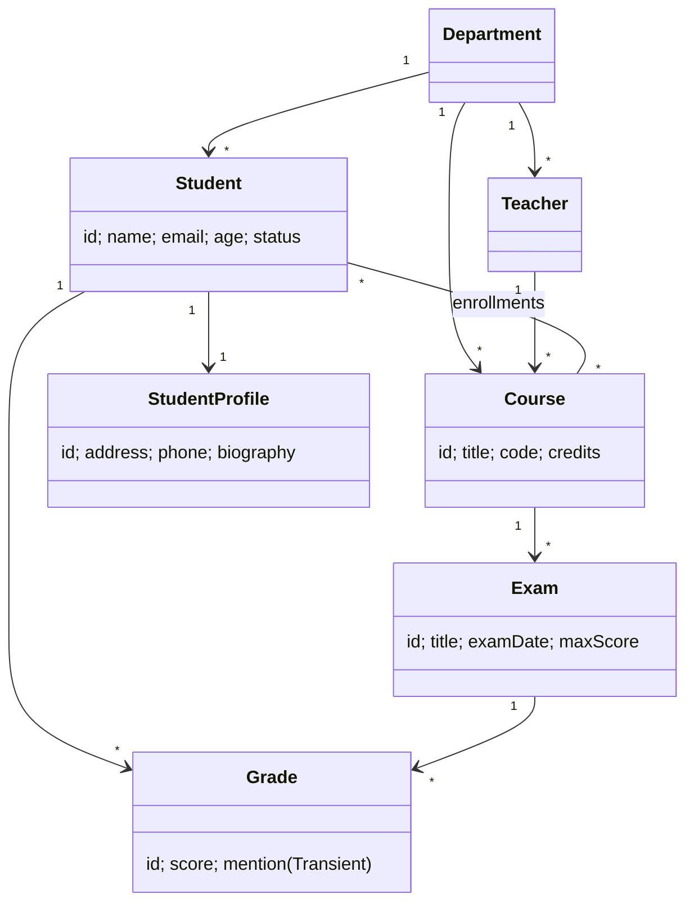

# Projet2 – Gestion universitaire (Spring Boot + MySQL)

Mini-projet réalisé dans le cadre du **DS1 – Développement Web (Spring Boot)**.
Il suit exactement la démarche du cours : Chapitre 1 (Java), Chapitre 2 (Transition vers Spring Boot), Chapitre 3 (Intégration de la couche de persistance avec MySQL).

## 1. Contexte métier

Une université (ESB) souhaite gérer ses **départements**, **enseignants**, **cours**, **étudiants**, **examens** et **notes**.
Le projet est l'extension du cas `User` / `Department` vu en cours (Chapitre 3) : l'utilisateur devient `Student` / `Teacher`, et on ajoute les cours, examens et notes.

## 2. Technologies

| Technologie | Rôle |
|---|---|
| Java 17, Spring Boot 3.3.5 | Application autonome (Tomcat intégré) |
| Spring Web | API REST |
| Spring Data JPA (Hibernate) | Couche de persistance |
| Spring Data JDBC | Dépendance du cours (Chapitre 2) |
| **MySQL** + MySQL Driver | Base de données |
| H2 | Base en mémoire (tests + profil `h2`) |
| Validation (Bean Validation) | Validation des données (exigée par le DS) |
| Postman | Tests de l'API |

## 3. Architecture en couches (Chapitre 2)

```
Client (Postman) ──HTTP──► Controller ──► Service ──► Repository (JPA) ──► MySQL
   Présentation              Métier       Persistance       Base de données
```

```
src/main/java/com/esb/projet2/
 ├─ model/        Entités JPA (Department, Teacher, Student, StudentProfile, Course, Exam, Grade, StudentStatus)
 ├─ repository/   Interfaces JpaRepository + requêtes personnalisées
 ├─ service/      Logique métier et règles de gestion
 ├─ controller/   Endpoints REST (@RestController)
 ├─ exception/    Gestion centralisée des erreurs
 └─ Projet2Application.java
src/main/resources/application.properties
src/test/java/…   Tests JUnit
```

## 4. Modèle de données (7 entités)



| Relation | Type JPA | Annotation |
|---|---|---|
| Department → Student / Teacher / Course | OneToMany / ManyToOne | `@OneToMany(mappedBy)`, `@ManyToOne @JoinColumn` |
| Teacher → Course | OneToMany / ManyToOne | idem |
| Student ↔ StudentProfile | **OneToOne** | `@OneToOne @JoinColumn(name="profile_id")` |
| Student ↔ Course | **ManyToMany** | `@ManyToMany @JoinTable(name="enrollments")` |
| Course → Exam, Exam → Grade, Student → Grade | OneToMany / ManyToOne | idem |

Autres annotations du Chapitre 3 utilisées : `@Id`, `@GeneratedValue`, `@Column(nullable, unique)`, `@Enumerated(EnumType.STRING)` (StudentStatus), `@Lob` (biographie), `@Transient` (mention de la note).

## 5. Requêtes personnalisées (6, besoins métier distincts)

| # | Repository | Méthode | Besoin métier |
|---|---|---|---|
| 1 | TeacherRepository | `findTeachersByDepartmentName` (@Query) | Enseignants d'un département |
| 2 | StudentRepository | `findStudentByDepartmentName` (@Query) | Étudiants d'un département |
| 3 | StudentRepository | `findByStatus` (dérivée) | Étudiants actifs / diplômés / suspendus |
| 4 | CourseRepository | `findCoursesByStudentId` (@Query + JOIN) | Cours suivis par un étudiant |
| 5 | CourseRepository | `findPopularCourses` (@Query + SIZE) | Cours avec au moins N inscrits |
| 6 | GradeRepository | `findAverageOn20ByStudentId` (@Query + AVG) | Moyenne d'un étudiant sur 20 |

## 6. Règles métier et gestion des erreurs

* Email / code de cours / nom de département **uniques**.
* Un étudiant ne peut pas s'inscrire **deux fois** au même cours.
* Une note n'est possible que si l'étudiant est **inscrit au cours** de l'examen, **≤ barème**, et **une seule note** par étudiant et par examen.
* Impossible de supprimer un département, enseignant, cours, examen ou étudiant encore référencé.
* Validation : `@NotBlank`, `@Email`, `@Min`, `@Max`, `@Positive`, `@NotNull` + `@Valid`.

| Code | Situation |
|---|---|
| 200 | Succès |
| 201 | Ressource créée (POST) |
| 400 | Validation, JSON invalide, règle métier violée |
| 404 | Ressource non trouvée |
| 500 | Erreur interne |

Format d'erreur : `{ "timestamp", "status", "error", "message" }`.

## 7. Endpoints

Base URL : `http://localhost:8080`

| Ressource | Endpoints |
|---|---|
| **Départements** `/api/departments` | `GET /` · `GET /{id}` · `POST /` · `PUT /{id}` · `DELETE /{id}` |
| **Enseignants** `/api/teachers` | CRUD · `GET /department/{departmentName}` · `POST /{teacherId}/department/{deptId}` |
| **Cours** `/api/courses` | CRUD · `GET /student/{studentId}` · `GET /popular/{minStudents}` · `POST /{courseId}/teacher/{teacherId}` · `POST /{courseId}/department/{deptId}` |
| **Étudiants** `/api/students` | CRUD · `GET /department/{departmentName}` · `GET /status/{status}` · `GET /{id}/average` · `POST /{studentId}/department/{deptId}` · `POST /{studentId}/courses/{courseId}` · `DELETE /{studentId}/courses/{courseId}` |
| **Examens** `/api/exams` | CRUD · `GET /course/{courseId}` |
| **Notes** `/api/grades` | CRUD · `GET /student/{studentId}` · `GET /exam/{examId}` |

Exemple – création d'un étudiant :
```json
POST /api/students
{ "name": "Alice", "email": "alice@esb.tn", "age": 20, "status": "ACTIVE",
  "department": { "id": 1 },
  "profile": { "address": "Tunis", "phone": "20123456", "biography": "..." } }
```

## 8. Instructions d'exécution

**Prérequis** : JDK 17+, Maven 3.9+ (ou Spring Tools / IntelliJ), MySQL 8, Postman.

1. **Installer MySQL** : <https://dev.mysql.com/downloads/>
2. **Créer la base** (Chapitre 3) : exécuter `database/init.sql` ou `CREATE DATABASE projet2;`
3. **Configurer** `src/main/resources/application.properties` : remplacer `spring.datasource.password=yourpassword` par votre mot de passe MySQL.
4. **Lancer** : `mvn spring-boot:run` (ou *Run As → Spring Boot App* dans Spring Tools). Les tables sont créées automatiquement (`ddl-auto=update`).
5. **Sans MySQL (H2, Chapitre 2)** : `mvn spring-boot:run -Dspring-boot.run.profiles=h2` – console H2 : <http://localhost:8080/h2-console> (JDBC URL `jdbc:h2:mem:testdb`, user `sa`, mot de passe `password`).
6. **Tests JUnit** (H2 en mémoire) : `mvn test`
7. **Tests Postman** : importer `postman/Projet2.postman_collection.json`, puis *Run collection* (dans l'ordre). Enregistrer les captures dans `screenshots/`.

## 9. Équipe
Voir `docs/ROLES_ET_TACHES.md`.
